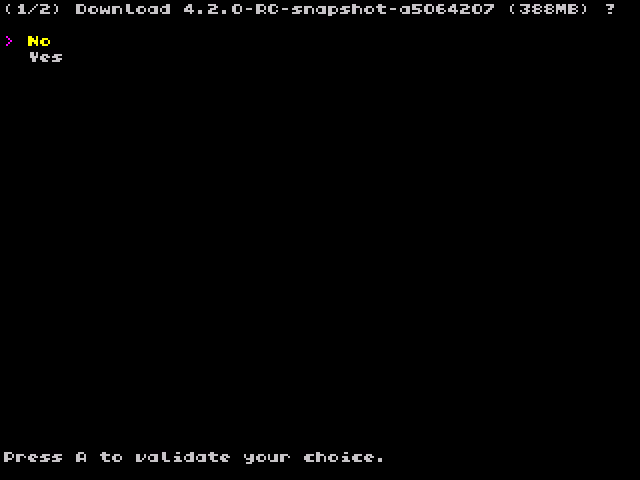

# Onion OTA update

Keep your Onion up-to-date, effortlessly!

## Presentation

Using WiFi, this app allows you to update your Onion without even touching your SD card or a computer.  
Allows you to select stable or beta channel.

## Usage

Onion OTA update is available in [Package Manager](package-manager). It will work only with WiFi/Miyoo Mini+.

Once installed run it from Apps section.

## Advanced

[Onion OTA update script](https://github.com/OnionUI/Onion/blob/main/static/build/.tmp_update/script/ota_update.sh).

### Detailed features

- stable or beta channel available (set on beta currently)
- check and enable WiFi connection if necessary
- compare current Onion version vs last released version on Github
- displays the size of the release before downloading
- verify the size of the downloaded file before applying
- check the current space available before applying update (currently 1GB is required)
- check disk integrity with fsck.fat, important to avoid SD card FAT file system corruption
- generate different exit error codes

## Troubleshooting GitHub connection errors

Older OTA scripts use the device's `wget` to check GitHub and download releases.
Its older TLS implementation can fail even when WiFi works. Switching to `curl`
alone can then expose `curl: (60) ... unable to get local issuer certificate` if
the device's CA store is missing or outdated.

OTA uses the bundled `curl` and Mozilla CA certificates in
`.tmp_update/certificates/cacert.pem` for HTTPS requests. Certificate verification
stays enabled, and stable/beta updates still come from `OnionUI/Onion`.

For an existing installation, back up `.tmp_update/script/ota_update.sh`, then
copy the updated script and the entire `.tmp_update/certificates/` directory from
the same build to the SD card. Copying only the script is insufficient. Safely
eject the card, boot the Mini Plus, connect to WiFi and run Onion OTA update.

The connection check prints curl's diagnostic instead of hiding it. Check the
device date and time for certificate validity errors, the CA bundle for errors
60/77, and the network/DNS for resolution or connection errors. Do not bypass
verification with `--insecure` or `--no-check-certificate`.

A Mini V4 card updated inside a Mini Plus needs these files on its own card too.
The updater retains the release-size check and stops on a failed download before
applying an update. The CA bundle does not add package-signature verification.
